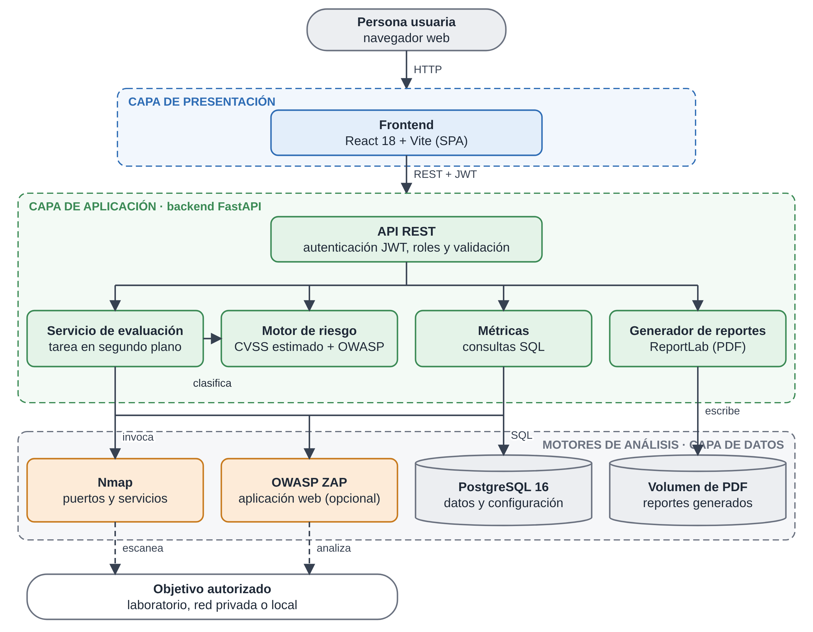

# SecureScan – Plataforma de Evaluación y Gestión de Vulnerabilidades Web

## Descripción
SecureScan permite a una organización registrar sus aplicaciones web, ejecutar evaluaciones de seguridad
automatizadas en ambientes controlados y autorizados, y obtener hallazgos priorizados por riesgo (CVSS / OWASP Top 10).
Está dirigida a pymes y equipos de TI sin presupuesto para herramientas comerciales de seguridad.

## Integrantes y roles
- **Ivan Escobar** – Proyecto individual (autorizado por la docente). Arquitectura, backend, frontend, motor de escaneo y pruebas.

## Tecnologías
- **Backend:** Python 3.12, FastAPI, SQLAlchemy, JWT (PyJWT), bcrypt
- **Frontend:** React 18 + Vite (React Router, gráficos SVG propios, sin librerías de gráficos)
- **Reportes:** ReportLab (PDF generado en el servidor)
- **Base de datos:** PostgreSQL 16
- **Escaneo:** Nmap (puertos y servicios) y OWASP ZAP (aplicación web, opcional)
- **Despliegue:** Docker + Docker Compose

## Arquitectura
Frontend (React) → API REST (FastAPI + JWT/RBAC) → Motor de Escaneo / Riesgo / Reportes → PostgreSQL.



Más diagramas (componentes, ER, clases, secuencias, estados y despliegue) en [`docs/diagramas`](docs/diagramas).

Estructura del repositorio:
```
backend/    API FastAPI (models, security, routers/, scanner, risk, scan_service, reportes_pdf, tests/)
frontend/   Interfaz React: 19 pantallas (ver frontend/README.md)
docs/       Documentación: diseño y diagramas (diseno.md), manual técnico (manual_tecnico.md), resultados de rendimiento
            y entregables Word (docs/entregables: requerimientos, diseño, plan de pruebas y manual técnico)
docker-compose.yml
```

## Cómo ejecutar el proyecto
### Con Docker (recomendado)
```bash
cp .env.example .env        # ajusta las claves
docker compose up --build
```
- Frontend: http://localhost:5173
- API + documentación interactiva: http://localhost:8000/docs

### Primer uso
1. Abre http://localhost:5173 y crea una cuenta. **La primera cuenta queda como administradora**; las demás parten como *usuario*.
2. Crea un proyecto y registra un activo con la URL `http://juiceshop:3000` (aplicación vulnerable de laboratorio incluida en el compose).
3. Pulsa **Iniciar evaluación**. Verás el avance en vivo, el mapa de puertos y los hallazgos priorizados.
4. Desde **Reportes** genera el informe PDF; desde **Usuarios y roles** (admin) crea cuentas y cambia roles.

> Si actualizas desde una versión anterior **no necesitas borrar la base**: al arrancar, el backend agrega solas las columnas nuevas (`app/migrar.py`).

### API
Documentación interactiva en http://localhost:8000/docs. Resumen:

| Área | Endpoints | Quién |
|---|---|---|
| Sesión | `POST /auth/register`, `POST /auth/login`, `GET /auth/me`, `PATCH /auth/me`, `POST /auth/password` | Todos |
| Proyectos y activos | `GET/POST /proyectos`, `GET/POST /proyectos/{id}/activos`, `GET /activos` | Dueño o admin |
| Evaluaciones | `POST/GET /activos/{id}/evaluaciones`, `GET /evaluaciones`, `GET /evaluaciones/{id}` | Dueño o admin |
| Hallazgos | `PATCH /hallazgos/{id}` (marcar corregido o reabrir) | Dueño o admin |
| Métricas | `GET /metricas` (totales por severidad, OWASP y semana, calculados con SQL) | Lo que el usuario puede ver |
| Reportes | `GET /reportes`, `POST /proyectos/{id}/reportes`, `GET /reportes/{id}/descargar` (PDF), `DELETE /reportes/{id}` | Dueño o admin |
| Usuarios | `GET/POST /usuarios`, `PATCH /usuarios/{id}` (rol, activar/desactivar) | Solo admin |
| Configuración | `GET /configuracion` (todos), `PUT /configuracion` | Escribir: solo admin |

Detalles de diseño que conviene conocer:
- **Sin acceso a lo ajeno:** un recurso de otro usuario responde 404 (no 403), para no revelar que existe (OWASP A01).
- **Cuenta desactivada = acceso cortado al instante**, aunque su token siga vigente.
- **Un solo escaneo a la vez por activo** (409 si ya hay uno en curso). Si el servidor se reinicia a mitad de un escaneo, esa evaluación se marca como fallida en vez de quedar colgada.
- **Contraseña temporal:** al crear una cuenta, el servidor genera una contraseña aleatoria y la muestra una sola vez.
- **Avance de la evaluación por etapas** (validar, escanear, clasificar, guardar). Nmap es un único proceso, así que no hay porcentaje fino dentro del escaneo de puertos.
- **Retención:** `retencion_dias` borra evaluaciones antiguas tras cada escaneo, pero conserva siempre la última completada de cada activo.

### Límites de seguridad del escáner
- Solo escanea redes privadas/loopback (laboratorio). Un objetivo público se rechaza y la evaluación queda *fallida* sin ejecutar Nmap.
- **Dos candados para las IP públicas:** la variable de entorno `ALLOW_PUBLIC_SCANS` (la fija quien administra el servidor) y el interruptor en *Configuración*. Se necesitan ambos: si la variable es `false`, ninguna configuración hecha desde la web puede abrirlas.
- El perfil de puertos, el tiempo máximo y la detección de versiones se eligen en *Configuración* y se validan en el servidor (lista cerrada de perfiles, sin texto libre que llegue a Nmap).
- **OWASP ZAP** es opcional: se activa en *Configuración* si el servidor tiene `ZAP_URL`. Analiza la misma IP ya validada. Su **escaneo activo** (que envía ataques de prueba) está apagado por defecto. Si ZAP falla, la evaluación termina igual con los resultados de Nmap y una advertencia. Nikto no está integrado.
- ZAP se probó con un **simulacro** de su API, no con ZAP real; valídalo evaluando Juice Shop con `docker compose up`.
- Se resuelve el host a IP una sola vez y se escanea esa IP (evita cambios de DNS entre la validación y el escaneo). Nmap se invoca sin shell.
- El puntaje **CVSS es una estimación basada en reglas** según el servicio expuesto, no un cálculo vectorial completo de CVSS v3.1.

### Pruebas automatizadas del backend
```bash
cd backend
python -m venv .venv && source .venv/bin/activate
pip install -r requirements.txt
pytest
```

## Metodología
Kanban personal con ciclos alineados a las fases de Capstone (Planificar → Desarrollar → Revisar → Ajustar).
Todo el avance queda registrado en commits de este repositorio.

## Estado del desarrollo
- [x] Modelo de datos (Usuario, Proyecto, Activo, Evaluación, Hallazgo, Reporte)
- [x] Autenticación JWT + control de acceso por roles (RBAC)
- [x] CRUD de proyectos, activos y evaluaciones con control de propiedad
- [x] Dashboard base (login, proyectos, activos, iniciar evaluación)
- [x] Pruebas funcionales y de seguridad (93 pruebas automáticas, más 1 que usa Nmap real y se omite si no está instalado)
- [x] Motor de escaneo Nmap en segundo plano + validación de objetivo
- [x] Motor de riesgo por reglas (CVSS estimado / OWASP Top 10)
- [x] Dashboard con hallazgos, resumen por severidad y actualización automática
- [x] Interfaz completa de 19 pantallas conectada a la API real
- [x] Reportes PDF generados en el servidor
- [x] Gestión de usuarios y roles, perfil, configuración de escaneo
- [x] Avance de la evaluación en vivo y marcado de hallazgos corregidos
- [x] Migración automática de columnas para bases creadas con versiones anteriores
- [x] Integración OWASP ZAP (probada con un simulacro; falta validar contra ZAP real)
- [x] Consultas SQL de agregación en el servidor (`/metricas`), verificadas contra un cálculo independiente
- [x] Pruebas de rendimiento (hallazgo y corrección de un problema N+1) y manual técnico
- [ ] Validación completa con `docker compose up` (PostgreSQL + ZAP real)
- [ ] Paginación de `GET /evaluaciones` y cancelación de evaluaciones en curso
