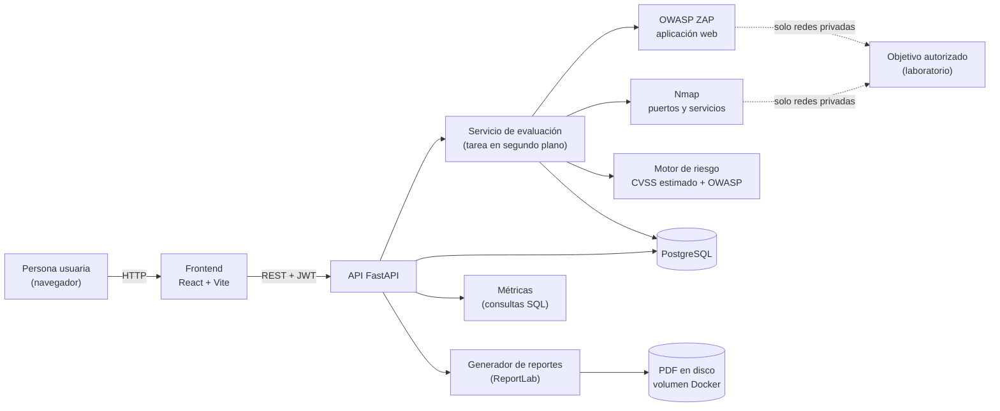
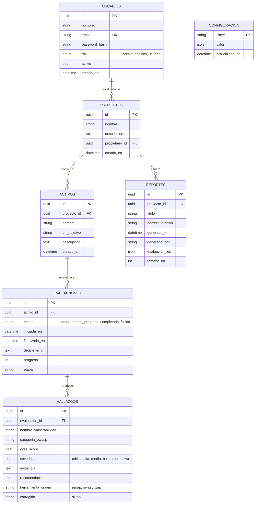
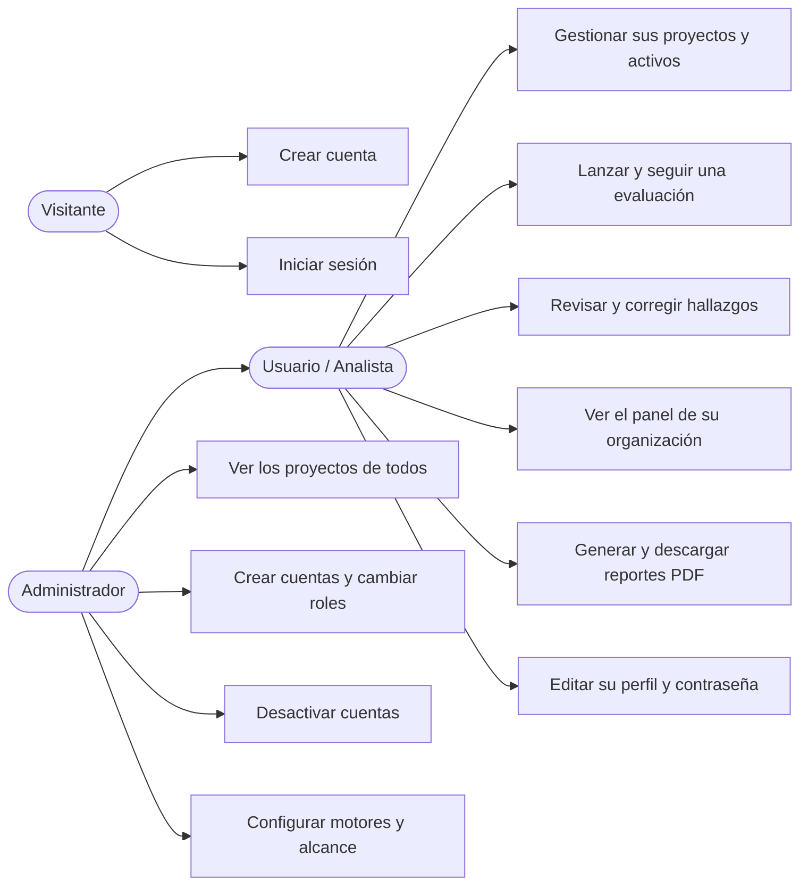
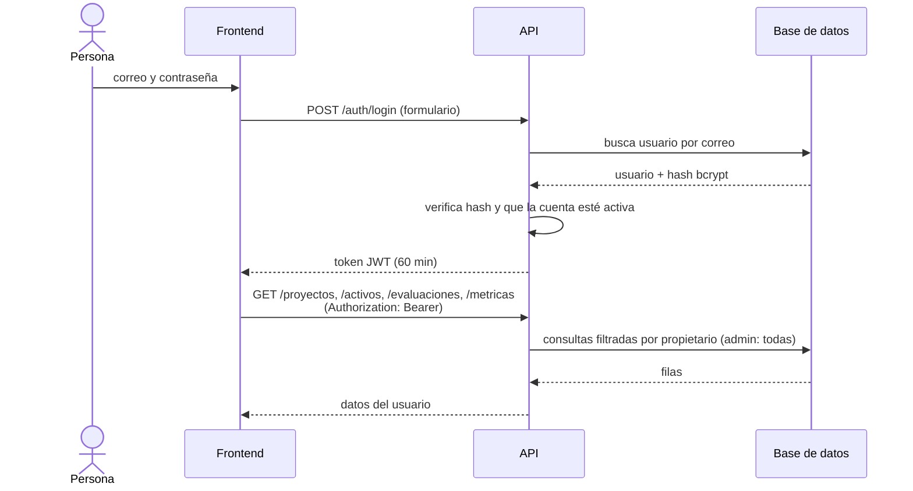
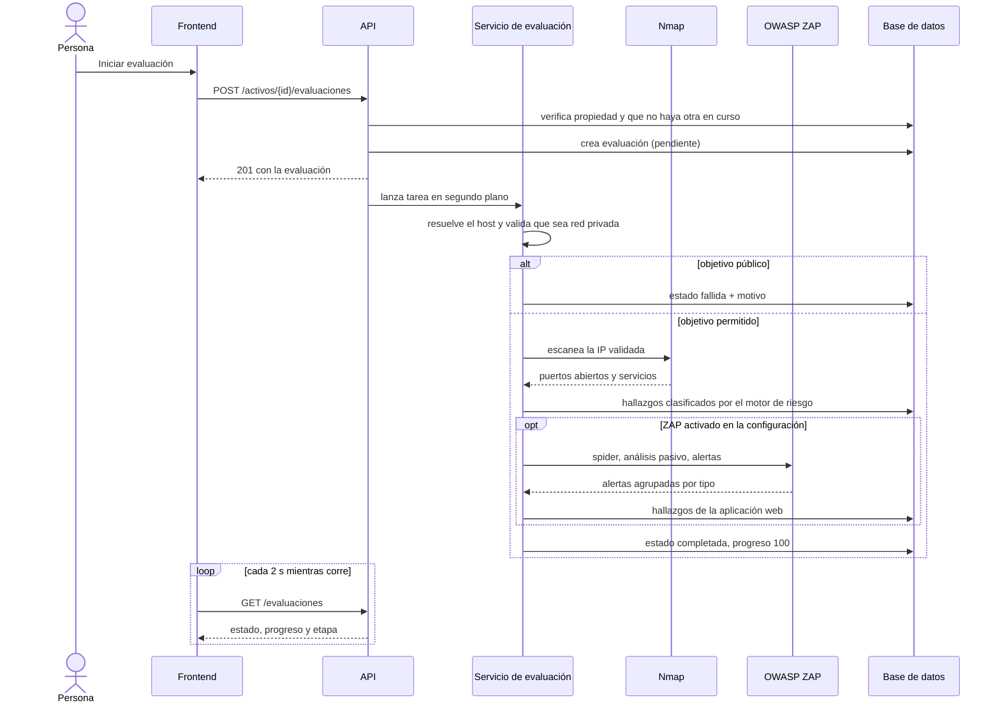
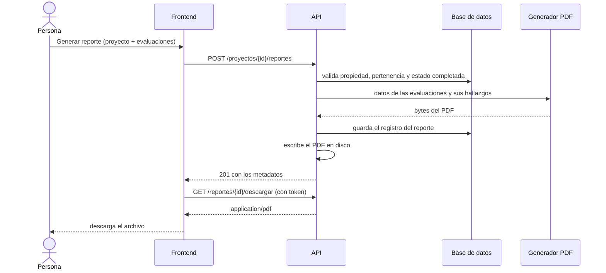

# SecureScan · Documento de diseño

Este documento describe cómo está construida la plataforma: requisitos, modelo de datos, arquitectura, casos de uso y flujos principales. Todo corresponde a lo implementado en este repositorio. Los diagramas se escriben en Mermaid (GitHub los dibuja al abrir este archivo); hay copias en imagen en la carpeta `diagramas/`.

## 1. Requisitos

### Funcionales
| Id | Requisito | Estado |
|---|---|---|
| RF1 | Registrar usuarios e iniciar sesión (JWT). El primer usuario del sistema es administrador. | Hecho |
| RF2 | Organizar el trabajo en proyectos y registrar activos (aplicaciones o servidores) dentro de ellos. | Hecho |
| RF3 | Lanzar una evaluación sobre un activo y seguir su avance en vivo. | Hecho |
| RF4 | Detectar puertos y servicios expuestos (Nmap). | Hecho |
| RF5 | Detectar vulnerabilidades de la aplicación web (OWASP ZAP). | Hecho, probado con un simulacro de ZAP (ver §8) |
| RF6 | Clasificar cada hallazgo con severidad (bandas CVSS), CVSS estimado y categoría OWASP Top 10. | Hecho |
| RF7 | Marcar hallazgos como corregidos y reabrirlos. | Hecho |
| RF8 | Mostrar un panel con totales por severidad, por categoría OWASP y por semana. | Hecho |
| RF9 | Generar y descargar un reporte PDF por proyecto. | Hecho |
| RF10 | Administrar usuarios y roles (crear, cambiar rol, desactivar). | Hecho |
| RF11 | Configurar motores de escaneo y reglas de alcance. | Hecho |

### No funcionales
| Id | Requisito | Cómo se cumple |
|---|---|---|
| RNF1 | Uso solo en entornos autorizados | El objetivo se resuelve a IP una vez y se rechazan las públicas; dos candados (variable de entorno y configuración) para habilitarlas. |
| RNF2 | Control de acceso | JWT + roles; cada usuario solo ve sus proyectos; un recurso ajeno responde 404. |
| RNF3 | Contraseñas protegidas | Hash bcrypt; nunca en texto plano; mínimo 8 caracteres. |
| RNF4 | Entrada validada | Esquemas Pydantic en cada endpoint; listas cerradas para opciones del escáner. |
| RNF5 | Rendimiento | Panel calculado con SQL (`GROUP BY`); listados con carga anticipada y ventana por activo (ver `rendimiento_resultados.md`). |
| RNF6 | Mantenibilidad | 93 pruebas automáticas; migración automática de columnas; configuración por variables de entorno. |
| RNF7 | Despliegue reproducible | Docker Compose con base de datos, API, interfaz, ZAP y un objetivo de laboratorio. |

## 2. Arquitectura

**Decisiones principales**
- **Evaluación en segundo plano.** La API responde al instante y el escaneo corre aparte con su propia sesión de base de datos; la interfaz consulta el estado cada 2 segundos.
- **Un motor de riesgo propio por reglas.** Traduce puerto y servicio a hallazgo; ZAP traduce su nivel de riesgo. El CVSS es una **estimación por reglas**, no un cálculo vectorial, y así se declara en pantalla e informes.
- **Resolver una vez, escanear esa IP.** Evita que un cambio de DNS entre la validación y el escaneo desvíe el análisis hacia un sistema no autorizado. ZAP recibe la misma IP validada.
- **El reporte es una foto.** El PDF se genera y guarda al pedirlo; no cambia si luego se corrigen hallazgos.
- **Cálculos del panel en la base de datos.** Los totales no dependen de que el navegador descargue todo el historial.

## 3. Modelo de datos

**Notas de diseño**
- Las claves son UUID: no se pueden adivinar ni enumerar.
- `REPORTES.evaluacion_ids` es una lista JSON y no una tabla intermedia: el informe es una foto de las evaluaciones elegidas y no se consulta al revés (de evaluación a reportes).
- `CONFIGURACION` es una tabla clave-valor con una sola clave (`escaneo`); agregar ajustes no exige migrar columnas.
- "Hallazgo vigente" no es una columna: es el conjunto de hallazgos de la **última evaluación completada** de cada activo. El historial queda guardado, pero solo lo vigente cuenta como riesgo actual.
- `herramienta_origen` permite mezclar Nmap y ZAP en una misma evaluación.

## 4. Roles y casos de uso

Hoy **analista** y **usuario** tienen los mismos permisos; el rol existe en el modelo y se separará cuando haya distinción entre lectura y escritura.

### Descripción de los casos de uso principales

| Caso | Actor | Flujo normal | Alternativas |
|---|---|---|---|
| Lanzar evaluación | Usuario | Elige un activo, confirma que tiene autorización, la API crea la evaluación y la interfaz muestra el avance. | Si ya hay una en curso: 409. Si el objetivo es público: la evaluación termina como fallida con el motivo. |
| Corregir un hallazgo | Usuario | Abre el hallazgo, lo marca como corregido; el panel baja los abiertos. | Puede reabrirlo. |
| Generar reporte | Usuario | Elige proyecto y evaluaciones completadas; el servidor genera el PDF y la interfaz lo descarga. | Evaluaciones ajenas o no completadas: 400. |
| Crear cuenta | Administrador | Indica nombre, correo y rol; el servidor genera una contraseña temporal y la muestra una sola vez. | Correo repetido: 400. |
| Desactivar cuenta | Administrador | La cuenta pierde el acceso al instante, aunque tenga una sesión abierta. | No puede desactivarse a sí mismo. |

## 5. Flujos principales (diagramas de secuencia)

### 5.1 Iniciar sesión y consultar datos

### 5.2 Evaluar un activo

### 5.3 Generar y descargar un reporte

## 6. Seguridad por diseño

| Riesgo (OWASP Top 10) | Medida |
|---|---|
| A01 Control de acceso | Filtro por propietario en cada consulta; 404 en lugar de 403; rutas de administración exigen rol; cuenta desactivada = token inútil. |
| A02 Fallas criptográficas | bcrypt para contraseñas; JWT firmado con `SECRET_KEY`. |
| A03 Inyección | SQLAlchemy con parámetros enlazados; Nmap se invoca con lista de argumentos (sin shell) y la IP pasa por `ipaddress`; los perfiles de puertos son una lista cerrada. |
| A04 Diseño inseguro | El escáner no puede apuntar a internet por accidente: dos candados independientes. |
| A05 Configuración | Secretos por variables de entorno; ZAP no publica puertos; escaneo activo de ZAP apagado por defecto. |
| A07 Autenticación | Contraseña mínima de 8 caracteres; contraseñas temporales aleatorias; mensaje de error genérico en el login. |

## 7. Decisiones que se tomaron y por qué

| Decisión | Motivo |
|---|---|
| FastAPI + SQLAlchemy | Validación y documentación automática (`/docs`); rapidez de desarrollo para un proyecto individual. |
| Tarea en segundo plano de FastAPI y no una cola (Celery) | Un solo servidor y pocas evaluaciones simultáneas; menos piezas que operar. Costo: si el servidor se reinicia, la evaluación en curso se marca como fallida. |
| Avance por etapas, no por porcentaje fino | Nmap es un único proceso y no informa avance de forma confiable. |
| Interfaz sin librerías de gráficos | Gráficos SVG propios: se pueden explicar línea por línea y no suman dependencias. |
| CVSS estimado por reglas | Un CVSS vectorial real exige datos que un escáner de puertos no entrega; se prefirió ser transparente a aparentar precisión. |

## 8. Limitaciones conocidas

- **ZAP se probó con un simulacro**, no con ZAP real. La lógica (flujo, agrupación, severidades, errores) está cubierta por pruebas; falta validarlo evaluando Juice Shop con el servicio `zap` del Compose.
- **Rendimiento medido sobre SQLite**, no PostgreSQL, y con un solo usuario (ver `rendimiento_resultados.md`).
- **La interfaz solo muestra las 10 evaluaciones más recientes de cada activo** (el panel y los totales sí cubren todo el historial). Un reporte que incluya una evaluación más antigua la tendrá en el PDF, pero no en su vista previa web.
- **Las evaluaciones no se pueden cancelar** una vez iniciadas.
- **`GET /evaluaciones` no está paginado** (se limita por activo con `?ultimas=N`).
- **No hay cierre de sesión en el servidor** (el token expira a los 60 minutos).
- **No hay recuperación ni restablecimiento de contraseña**: quien la olvida necesita que un administrador le cree una cuenta nueva.
